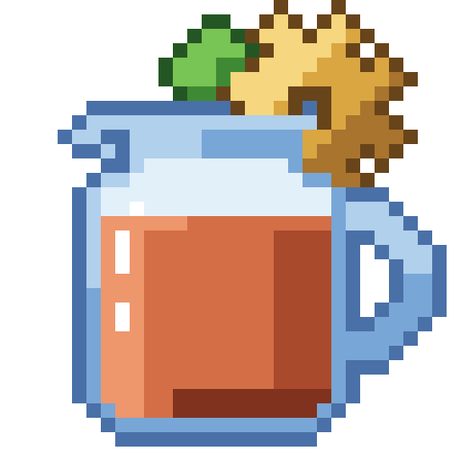

# Engineer's Tea

A relaxed Create pack: build, brew, explore dungeons and beat bosses with friends.

## The loop

Build a Create factory at home, cook Farmer's Delight meals, explore dungeons and beat a boss. Each boss drops a key for everyone nearby; bring it home, learn it with ProjectE and automate it to unlock the next chapter. Five chapters end in the Engineer's Tea.

Playing on the group server: [docs/players.md](docs/players.md). Hosting it: [docs/guides/local-server-docker.md](docs/guides/local-server-docker.md) and [docs/guides/pregenerate-world.md](docs/guides/pregenerate-world.md).

## Design

The pack design is in [docs/design.md](docs/design.md); the current implementation plan is in [docs/plans/](docs/plans/); performance results in [docs/perf/](docs/perf/).

## Install

Install with the Modrinth App or Prism Launcher by importing the `.mrpack`. Get it on [Modrinth](https://modrinth.com/modpack/engineers-tea).

## Built with BastionPack

This pack is built from the [BastionPack](https://github.com/marr-cloud/BastionPack) template. See [docs/getting-started.md](docs/getting-started.md) to develop, test and release it.
